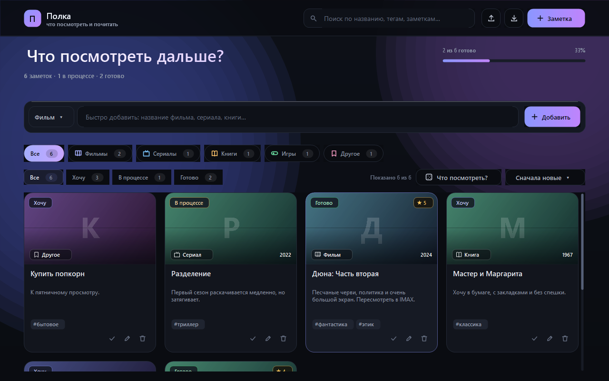

# Полка

Настольное приложение для Windows: список того, что хочется посмотреть, почитать или пройти.
Отдельное окно, свой значок, без браузера и без интернета.



## Запуск

Двойной щелчок по `Polka.exe`. Установка не нужна.
Требуется Windows 10/11 — .NET Framework 4.8 в них уже входит.

## Что умеет

- **Типы заметок:** фильм, сериал, книга, игра, другое.
- **Статусы:** «Хочу» → «В процессе» → «Готово». Кнопка ✓ на карточке переключает статус.
- **Оценка** звёздами, **теги**, **год**, ссылка на постер и текст заметки.
- **Поиск** по названию, тегам, году и тексту; фильтры по типу и статусу, сортировка.
- **Быстрое добавление** строкой сверху: ввели название — Enter.
- **🎲 «Что посмотреть?»** — случайная карточка из списка с подсветкой.
- **Прогресс** в шапке: сколько готово из всего списка.
- **Экспорт и импорт JSON** — резервная копия и перенос на другой компьютер.
- Полоса прокрутки, перетаскивание, горячие клавиши.

## Горячие клавиши

| Клавиши | Действие |
|---|---|
| `/` | перейти к поиску |
| `N` | новая заметка |
| `Esc` | закрыть редактор / очистить поиск |
| `Ctrl+Enter` | сохранить заметку в редакторе |

## Где хранятся данные

`%APPDATA%\Polka\notes.json` — обычный JSON, можно открыть блокнотом.
Данные не покидают компьютер. Для переноса используйте экспорт/импорт
(кнопки со стрелками в шапке).

При первом запуске в список добавляются примеры — их можно удалить.

## Сборка из исходников

Нужен `csc.exe` из .NET Framework (есть на любой Windows 10/11):

```bat
build.cmd
```

Исходники — в `src/` (C# 5, WinForms, без внешних зависимостей).
Значок — `assets/polka.ico`, собирается скриптом `tools/make_icon.py`.
